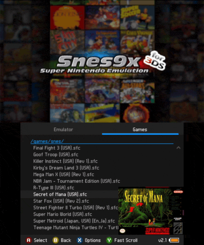
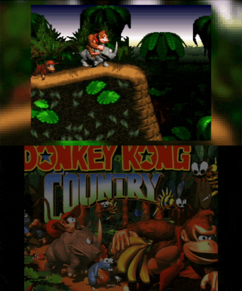
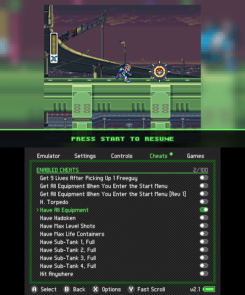
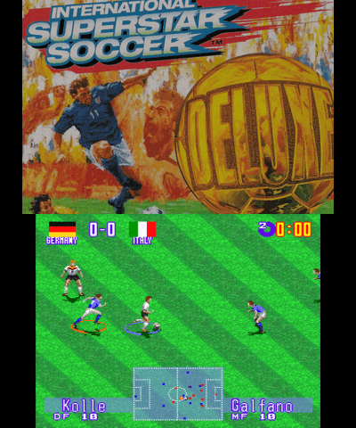
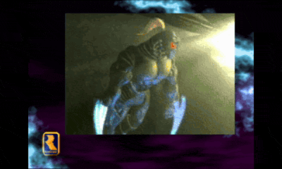
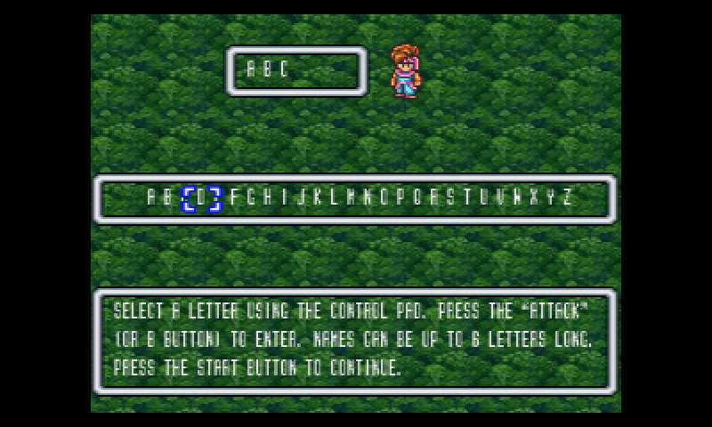
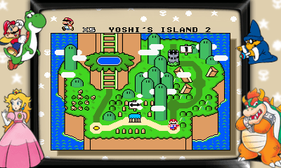
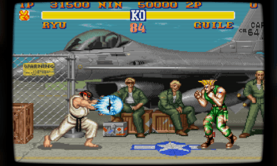
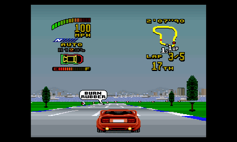
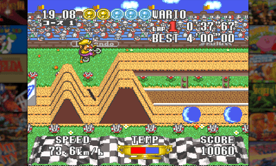

# Snes9x for 3DS

ここは、matbo87さんが作成してくれた「snes9x_3ds」を自分用にカスタマイズする場所です。

## 現在対応したこと
* タイトルロゴを１５００個まで対応させた
* 私用と分かるようにバージョン表記に「＋」をつけた
* ゲーム選択画面を日本語ファイルでも表示出来るようになった

## アセット(画像およびチート)
* 日本語ファイル対応アセットは専用のアセットリポジトリである[snes9x_3ds-assets](https://github.com/nohchan/snes9x_3ds-assets)に提供されています。

## Screenshots

<table>
  <tr>
    <td width="50%" align="center"></td>
    <td width="50%" align="center"></td>
  </tr>
  <tr>
    <td valign="top" width="50%" align="center">日本語ファイル名表示, Title enabled</td>
    <td valign="top" width="50%" align="center">Pause screen, per-game overlay enabled</td>
  </tr>
  <tr><td colspan="2"></td></tr>
  <tr></tr>
  <tr>
    <td width="50%" align="center"></td>
    <td width="50%" align="center"></td>
  </tr>
  <tr>
    <td valign="top" width="50%" align="center"><strong>Cheats enabled</strong> Mega Man X</td>
    <td valign="top" width="50%" align="center"><strong>Screen swap</strong> International Superstar Soccer Deluxe</td>
  </tr>
  <tr><td colspan="2"></td></tr>
  <tr></tr>
  <tr>
    <td width="50%" align="center"></td>
    <td width="50%" align="center"></td>
  </tr>
  <tr>
    <td valign="top" width="50%" align="center"><strong>MSU-1 video playback</strong> Killer Instinct: Arcade Edition</td>
    <td valign="top" width="50%" align="center"><strong>Enhanced Resolution: Off vs. 2x Screen</strong> Secret of Mana</td>
  </tr>
  <tr><td colspan="2"></td></tr>
  <tr></tr>
  <tr>
    <td width="50%" align="center"></td>
    <td width="50%" align="center"></td>
  </tr>
  <tr>
    <td valign="top" width="50%" align="center"><strong>Per-game overlay</strong> Super Mario World</td>
    <td valign="top" width="50%" align="center"><strong>Crop, overscan and scanlines</strong> Super Street Fighter II</td>
  </tr>
  <tr><td colspan="2"></td></tr>
  <tr></tr>
  <tr>
    <td width="50%" align="center"></td>
    <td width="50%" align="center"></td>
  </tr>
  <tr>
    <td valign="top" width="50%" align="center"><strong>In-Frame Palette Changes enabled</strong> Top Gear II</td>
    <td valign="top" width="50%" align="center"><strong>BS-X support</strong> Excitebike – Bunbun Mario Battle</td>
  </tr>
 </table>
  

## Credits

* The Snes9x team for the SNES emulator core, and the libretro Snes9x core maintainers for ongoing reference work
* bubble2k, original author of [snes9x_3ds](https://github.com/bubble2k16/snes9x_3ds), for creating the excellent base this fork builds on
* matbo87, [snes9x_3ds](https://github.com/matbo87/snes9x_3ds), for creating the excellent base this fork builds on
* Wyatt-James for the SuperFX optimizations and fixes ([#85](https://github.com/matbo87/snes9x_3ds/pull/85)), and for the safety, audio and stability fixes adapted from the [snes9x_3ds fork](https://github.com/Wyatt-James/snes9x_3ds)
* ramzinouri's [snes9x_3ds fork](https://github.com/ramzinouri/snes9x_3ds) inspired the image border/background and theme support
* willjow's [snes9x_3ds fork](https://github.com/willjow/snes9x_3ds) revived the project after development had gone quiet
* [RetroAchievements](https://retroachievements.org) for the achievement service, the rcheevos library and the community-made achievement sets
* The Citra/Azahar teams for making 3DS emulator testing and debugging practical
* Everyone reporting issues, testing games and suggesting improvements
